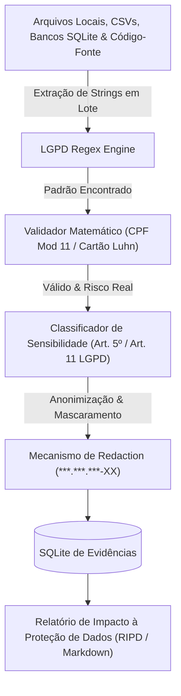

# ⚖️ LGPD PII Scanner Toolkit
## Scanner Automatizado para Identificação de Dados Pessoais Sensíveis e Conformidade Regulatória (Lei 13.709/2018)


[](https://techdimbr.github.io/techdimbr/)
[](https://www.techdim.com.br)
[](https://www.gov.br/anpd/pt-br)
[-3776AB.svg)](https://www.python.org)
[](README.md)
[](LICENSE)

> **Scanner estático e dinâmico para varredura de dados pessoais sensíveis (PII) em arquivos locais, bancos de dados e repositórios. Validação matemática rigorosa de dígitos verificadores (CPF e cartões) para evitar falsos positivos e geração automática de Relatório de Impacto à Proteção de Dados (RIPD).**

---

## 🏛️ Visão Geral & Proposta de Valor

Com as multas pesadas e sanções da Autoridade Nacional de Proteção de Dados (ANPD), empresas não podem correr o risco de manter arquivos não criptografados contendo CPFs, dados bancários e informações sensíveis de clientes espalhados em diretórios de rede.

O **LGPD PII Scanner Toolkit** entrega segurança jurídica e técnica para o Encarregado de Dados (DPO) e equipes de segurança:
1. **Zero Falsos Positivos:** Não utiliza apenas expressões regulares genéricas; aplica validação matemática do algoritmo de Módulo 11 da Receita Federal para CPFs e Algoritmo de Luhn para cartões de crédito.
2. **Geração de RIPD / Relatório de Conformidade:** Estrutura automaticamente os achados em formato Markdown, JSON e SQLite com mapeamento direto dos artigos da LGPD (Art. 7º Bases Legais, Art. 18 Direitos do Titular).
3. **Privacidade por Design:** O scanner opera 100% offline e localmente, mascarando os dados encontrados (`***.456.789-**`) para que o próprio relatório não se torne um vetor de vazamento.

---

## 🏗️ Fluxo de Varredura e Classificação



---

## ⚡ Início Rápido

### Comandos de Operação
```bash
# 1. Clonar o repositório
git clone https://github.com/Techdimbr/lgpd-pii-scanner-toolkit.git
cd lgpd-pii-scanner-toolkit

# 2. Inicializar o ambiente
./iniciar.sh

# 3. Executar a varredura demonstrativa com validação de CPFs
python3 03_APLICACAO/src/lgpd_scanner.py --demo
```

---

## 🛡️ Governança & Contato Corporativo
- **Autor:** Deivis Írio Mayer (Kether_1)
- **Entidade:** TECHDIM INOVA SIMPLES (I.S.) - ME · CNPJ 61.933.926/0001-24
- **Website Oficial:** [https://www.techdim.com.br](https://www.techdim.com.br)
- **Portal de Soluções:** [https://techdimbr.github.io/techdimbr/](https://techdimbr.github.io/techdimbr/)
